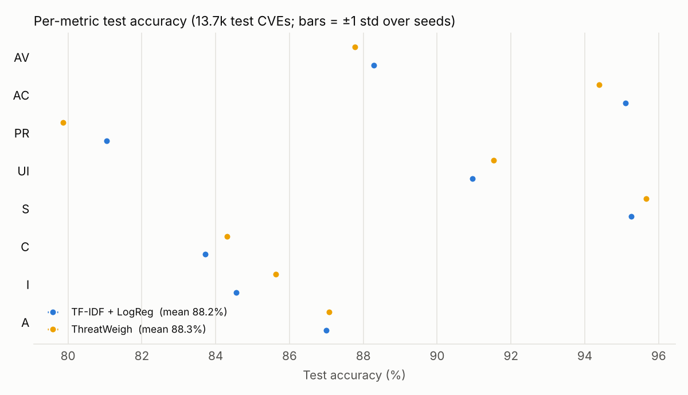
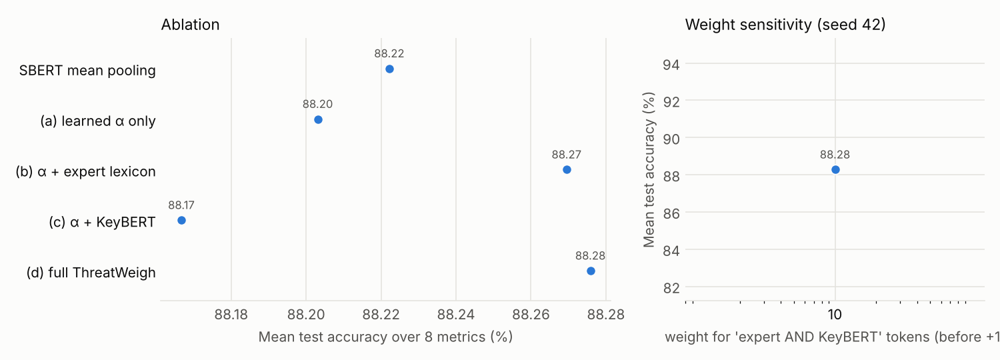

# ThreatWeigh

**Interpretable CVSS v3.1 prediction from vulnerability text.**

ThreatWeigh reads the English description of a software vulnerability (a CVE) and predicts
the 8 CVSS v3.1 Base metrics. It then feeds them into the official CVSS v3.1 formula to get
the 0–10 Base Score, and shows which words each prediction relied on.

ThreatWeigh is a **simplified, student-friendly re-implementation** of WSymBERT
(Mirtaheri et al., 2026; see [Credits](#10-credits-and-citation)). It follows the paper's equations,
but it is **not** a reproduction of the paper's numbers. The paper reports about 96.2% mean accuracy
on NVD. That figure is quoted here for reference only: ThreatWeigh's reported runs use a much
smaller compute budget (see [Compute budget](#compute-budget)).

> **Summary of findings (observed; one seed; CPU budget of 4,000 training rows; full 13,743-CVE test set):**
> * ThreatWeigh (88.28% mean accuracy), plain SBERT (88.22%) and TF-IDF + logistic regression (88.24%) are practically tied.
>   ThreatWeigh − SBERT = +0.05 pp (95% CI −0.02 to +0.13). The largest per-metric difference is on Privileges Required
>   (+0.52 pp), which is borderline after multiple-comparison correction (Holm p = 0.06).
> * The ablations and the weight values 5 / 10 / 20 all land within 0.11 pp of each other.
> * On newer CVEs (train ≤ 2021, test ≥ 2023), ThreatWeigh holds up better than TF-IDF (88.33% vs 87.15%; macro-F1 +4.6 pp).
> * Integrated-Gradients explanations of ThreatWeigh and SBERT are about equally faithful; ThreatWeigh's put slightly more
>   lexicon words in the top 10. Lexicon cues can also mislead (e.g. "administrator" → PR:High; see 6.7 and 6.8).
> * 9,199 descriptions in the source data contained their own CVSS vector or score (label leakage); they were cleaned.
>
> Every number below was produced by the code in this repository; none is estimated.

**Demo video:** [`video/threatweigh_demo.mp4`](video/threatweigh_demo.mp4) (3 min) shows the project flow, the CLI and the live app.

---

## 1. The problem

Every published CVE gets a CVSS vector such as `CVSS:3.1/AV:N/AC:L/PR:N/UI:N/S:U/C:H/I:H/A:H`.
Each part is one of 8 Base metrics:

| Metric | Name | Values |
|---|---|---|
| AV | Attack Vector | **N**etwork, **A**djacent, **L**ocal, **P**hysical |
| AC | Attack Complexity | **L**ow, **H**igh |
| PR | Privileges Required | **N**one, **L**ow, **H**igh |
| UI | User Interaction | **N**one, **R**equired |
| S | Scope | **U**nchanged, **C**hanged |
| C / I / A | Confidentiality / Integrity / Availability impact | **N**one, **L**ow, **H**igh |

Analysts pick these values by hand after reading the description, which is slow and inconsistent.
ThreatWeigh treats the task as **8 independent text-classification problems**, then computes the
score with the official formula.

## 2. Method

There is **one independent model per metric**: 8 models with no shared parameters and no multi-task loss.
Each model works like this:

```
CVE text ─► Sentence-BERT encoder ─► token vectors h_i ─► learned scores α_i ┐
        ├─► expert lexicon K_exp (CVSS decision trees) ┐                     ├─► fused pooling z ─► linear+softmax ─► label
        └─► KeyBERT top-5 words K_mdl ─────────────────┴─► symbolic weight w_i ┘
8 labels ─► official CVSS v3.1 formula ─► Base Score + severity
```

### 2.1 Encoder
The encoder is a Sentence-BERT checkpoint, loaded with Hugging Face Transformers and fine-tuned separately for each metric.
Inputs are truncated to 128 tokens. The checkpoint is set in `config.yaml → model.encoder`:

* default: `sentence-transformers/all-MiniLM-L6-v2` (22M parameters, practical on a CPU or small GPU)
* stronger option: `sentence-transformers/all-mpnet-base-v2` (110M parameters, needs a GPU)

The paper does not name its checkpoint; this choice is ours. (The authors' released code
uses `efederici/sentence-bert-base`.)

### 2.2 Learned pooling weights
For each token vector $h_i$:

$$s_i = W_{pool}\,h_i + b, \qquad \alpha_i = \frac{\exp(s_i)}{\sum_{j \in \text{real tokens}} \exp(s_j)}$$

Padding tokens are masked out, so they always get $\alpha_i = 0$.

### 2.3 Symbolic knowledge
* **Expert lexicon $K_{exp}$** (`src/lexicon.py` → `lexicons/expert_lexicon.json`). For each metric, a
  question-style decision tree written from the FIRST CVSS v3.1 specification. For example, AV asks:
  *"Is physical contact required?"* → P, *"Same local or radio network?"* → A, *"Local account or local
  access?"* → L, *"Otherwise remotely exploitable?"* → N. Each answer has hand-written cue phrases
  ("physical access", "bluetooth", "local users", "remote attackers", …).
  Cues are then checked on the **training split only**. A cue is kept if it occurs in at least 10 training
  descriptions and lift = P(label | cue) / P(label) ≥ 1.2. The lexicon is then frozen.
  No words are mined from the data, and test data is never used.
* **KeyBERT keywords $K_{mdl}$** (`src/keybert_cache.py`). The top 5 single words per description, scored by
  the same SBERT checkpoint (not fine-tuned) with `keyphrase_ngram_range=(1,1)`, no stop-word
  filtering and no MMR. They are cached to disk before training.

### 2.4 Symbolic weight per token
Multi-word lexicon phrases are mapped onto all of their sub-word tokens through the tokenizer's
character offsets:

$$w_i = \begin{cases} 10 & \text{token in } K_{exp} \text{ and } K_{mdl} \\ 1 & \text{in exactly one} \\ 0 & \text{otherwise}\end{cases} \qquad w_i \leftarrow w_i + 1 \;\in \{11, 2, 1\}$$

### 2.5 Fused pooling and classifier

$$\beta_i = \frac{\alpha_i\, w_i}{\sum_j \alpha_j w_j + \varepsilon}, \qquad z = \sum_i \beta_i h_i, \qquad p(y \mid x) = \mathrm{softmax}(W z + b)$$

Training uses cross-entropy with no class weighting, AdamW, learning rate 2e-5 and batch size 16. The best epoch
is chosen by validation accuracy, with early stopping. The test split is used **once**, at the end.

### 2.6 CVSS v3.1 Base Score (`src/cvss.py`)

$$ISS = 1-(1-C)(1-I)(1-A)$$
$$\text{Impact} = \begin{cases}6.42\cdot ISS & S{=}U\\ 7.52\,(ISS-0.029) - 3.25\,(ISS-0.02)^{15} & S{=}C\end{cases}$$
$$\text{Exploitability} = 8.22 \cdot AV \cdot AC \cdot PR \cdot UI$$

Base = 0 if Impact ≤ 0. Otherwise it is Roundup(min(Impact + Exploitability, 10)) when S is Unchanged,
or Roundup(min(1.08 · (Impact + Exploitability), 10)) when S is Changed. Roundup is the official integer-based
function from Appendix A of the spec. The calculator reproduces NVD's own score for **all 137,521 rows** of
the dataset (`tests/test_cvss.py`).

> Note on the project brief: it expected `AV:P/AC:L/PR:N/UI:N/S:U/C:L/I:L/A:L` → 4.6. The official value is
> **4.3** (ISS = 0.5254, Impact = 3.373, Exploitability = 0.915, sum 4.288 → 4.3), and NVD scores the 9 CVEs with this
> vector 4.3. The 4.6 belongs to `AV:P/AC:L/PR:N/UI:N/S:U/C:H/I:N/A:N`. The test checks both vectors.

### 2.7 Differences from the authors' released code
The released WSymBERT scripts differ from the paper's equations in a few places. ThreatWeigh follows the
**paper**:

| | Paper equations / ThreatWeigh | Released code (`Nvd/AV.py`) |
|---|---|---|
| token weight | 11 / 2 / 1 | `min(1 + w, 5)`, so capped at 5 |
| padding | masked out of the softmax | not masked |
| split | train / val / test | 80/20 train/val, no held-out test |
| epochs | 15 | 3 |

## 3. Data

* Source: `Nvd/Dataset/final.zip` from https://github.com/ShahbazianR/WSymBert, with 137,521 NVD CVEs from 2016–2024.
  Columns: `ID, text, vectorString, av … a, score, baseSeverity`. 100,122 rows have CVSS 3.1 vectors and 37,399
  have CVSS 3.0 vectors. Both versions define the 8 metrics identically, and our v3.1 calculator also matches NVD's
  score on the 3.0 rows.
* `combine/Dataset/final.zip` in the same repo is **byte-identical** (same MD5) to the NVD file, so it is not a
  separate dataset. ThreatWeigh uses one dataset and makes no claim about a "Combine" experiment.
* **Label leakage removed.** 9,199 descriptions (6.7%), mostly Oracle advisories, contain the answer, e.g.
  *"CVSS 3.1 Base Score 7.5 (Integrity impacts). CVSS Vector: (CVSS:3.1/AV:N/AC:L/PR:N/UI:N/S:U/C:N/I:H/A:N)."*
  On these rows any model can read the labels straight off the input. `src/data.py` strips such score and vector
  sentences before anything else, and `tests/test_data.py` checks that no vector remains in any split.
  This differs from the original dataset, so results are not directly comparable to models trained on the raw text.
* Preprocessing (`python -m src.data`): strip the leaked CVSS text, drop empty text, then strict de-duplication on
  lower-cased, whitespace-collapsed text (91 removed). That leaves **137,430 rows**. Then a stratified 80/10/10 split on AV
  with seed 42: **train 109,943 / val 13,744 / test 13,743**. A time-aware split by CVE ID year:
  train ≤ 2021 (90,267), val 2022 (21,821), test ≥ 2023 (25,342).

Label distribution of the training split (full table: `results/label_distribution.csv`). Note the heavy imbalance:

| AV | AC | PR | UI | S | C | I | A |
|---|---|---|---|---|---|---|---|
| N 73.9, L 23.0, A 2.1, P 1.0 | L 94.0, H 6.0 | N 62.4, L 29.4, H 8.2 | N 65.4, R 34.6 | U 82.3, C 17.7 | H 57.5, N 21.8, L 20.7 | H 49.5, N 31.1, L 19.3 | H 57.5, N 40.3, L 2.2 |

Because of this imbalance, accuracy flatters the rare classes, so macro-F1 is reported too.

## 4. Setup

```bash
python -m venv .venv
```

```bash
source .venv/bin/activate
```

```bash
pip install -r requirements.txt
```

A GPU is detected and used automatically if one is present. Everything also runs on a CPU.
The first run downloads `all-MiniLM-L6-v2` (~90 MB) and `distilbert-base-uncased` (~260 MB) from Hugging Face.

## 5. How to run each stage

All settings are in **`config.yaml`**. The `--profile` flag selects `quick` (smoke test), `budget` (what was run
for the results below) or `full` (paper settings: all training rows, 15 epochs).

**Everything, in order, resumable:** `bash scripts/run_all.sh`. A run or metric that has already finished is skipped,
so after an interruption you just start it again. `SEEDS="42 43 44" DISTILBERT=1 bash scripts/run_all.sh` adds
extra seeds and the DistilBERT baseline.

| Stage | Command |
|---|---|
| 1. Data + EDA | `python -m src.data` |
| 2. Tests | `python -m pytest` |
| 3a. Expert lexicon + coverage | `python -m src.lexicon` |
| 3b. KeyBERT cache (~35 min on 4 CPU cores) | `python -m src.keybert_cache` |
| 4. TF-IDF baseline | `python -m src.baselines tfidf --profile budget` |
| 4. SBERT mean-pooling baseline | `python -m src.baselines sbert --profile budget --seed 42` |
| 4. DistilBERT baseline (not run here; see Limitations) | `python -m src.baselines distilbert --profile budget --seed 42` |
| 5. ThreatWeigh | `python -m src.train --variant full --profile budget --seed 42 --save-model` |
| 6. Ablations | `python -m src.train --variant alpha_only` (also `alpha_expert`, `alpha_keybert`) |
| 6. Weight sensitivity | `python -m src.train --variant full --weight-both 5` (also 20) |
| 6. Temporal split | `python -m src.train --variant full --split temporal` |
| 6. Tables, figures, bootstrap | `python -m src.evaluate [--weight-stats]` |
| 7. Explainability | `python -m src.explain --tw <threatweigh run> --base <sbert run>` |
| 8. CLI | `python predict.py "A remote attacker can execute arbitrary code via a crafted request."` |
| 8. App | `streamlit run app.py` |

Smoke test of the whole pipeline on any CPU (a few minutes): `python -m src.train --variant full --quick`.

Each training run writes `results/runs/<run>/preds_<metric>.npz` (test probabilities),
per-epoch histories and `run.json`. With `--save-model`, it also writes the weights to `models/<run>/`.

## 6. Results

### Compute budget
The results were produced on a machine with **no GPU (4 CPU cores, 15 GB RAM)**. A paper-scale run (110k training rows,
15 epochs, 8 metrics, many variants) was not feasible there, so the reported runs use the `budget` profile:

* the **same** 4,000-row stratified training subsample for every model (drawn once with seed 42)
* a 1,000-row validation subsample for model selection, up to 3 epochs, early-stopping patience 2
* the same learning rate (2e-5) and batch size (16) as the paper
* length-bucketed batches: texts of similar length are batched together. This is ~1.8× faster on CPU, with the same model and loss.
* **one training seed (42)**. To save time, the 3-seed experiment, the weight-2 sensitivity point and the
  DistilBERT baseline were dropped. All of them can be run with `scripts/run_all.sh`.
* the **full 13,743-row test split** for every reported number

Each MiniLM configuration (8 models) took 38–49 minutes. Absolute accuracies are lower than a full-data GPU run would
give: TF-IDF alone goes from 88.2% to 91.4% when trained on all rows. **The comparisons between models are the
meaningful part**, because all models share the same rows, splits and hyperparameters.

### 6.1 Expert-lexicon coverage (test split)
Coverage is the % of descriptions with at least one cue match. The paper reports 83.6% on 2,000 CVEs with its own lexicon.

| Metric | AV | AC | PR | UI | S | C | I | A | **Any** |
|---|---|---|---|---|---|---|---|---|---|
| cues | 94 | 29 | 68 | 54 | 20 | 64 | 55 | 47 | 431 |
| coverage % (13,743 test CVEs) | 58.0 | 6.3 | 39.5 | 38.0 | 20.1 | 58.2 | 59.6 | 48.4 | **88.9** |
| coverage % (random 2,000) | 60.3 | 5.5 | 39.3 | 37.5 | 19.8 | 57.8 | 59.2 | 47.8 | **89.9** |

The lift filter cannot keep cues for very frequent labels. AC:L is 94% of training rows, so its lift can be at most ≈1.06,
and it kept no cues. S:U kept only 3. The lexicon is informative mainly for the minority labels.

### 6.2 Main comparison (test accuracy %, seed 42)
*Generated by `python -m src.evaluate` → `results/main_comparison.md`. Per-metric precision, recall and F1:
`results/per_metric.md`.*

| Model | train rows | AV | AC | PR | UI | S | C | I | A | mean acc | mean macro-F1 | score MSE | score MAE | severity acc |
|---|---|---|---|---|---|---|---|---|---|---|---|---|---|---|
| TF-IDF + LogReg | 4k | 88.3 | 95.1 | 81.1 | 90.9 | 95.3 | 83.7 | 84.6 | 87.0 | 88.24 | **75.15** | 2.519 | 0.933 | 66.66 |
| SBERT (mean pooling) | 4k | 87.8 | 94.5 | 79.3 | 91.5 | 95.7 | 84.2 | 85.7 | 87.1 | 88.22 | 74.51 | **2.225** | **0.901** | **67.55** |
| **ThreatWeigh** | 4k | 87.8 | 94.4 | 79.9 | 91.5 | 95.7 | 84.3 | 85.6 | 87.1 | **88.28** | 74.76 | 2.252 | 0.903 | 67.42 |
| *TF-IDF + LogReg (reference)* | *110k* | *92.5* | *96.3* | *85.4* | *94.2* | *96.7* | *88.1* | *88.4* | *89.8* | *91.41* | *84.19* | *1.801* | *0.682* | *75.95* |

The score MSE and MAE compare the Base Score computed from the 8 *predicted* labels with the score computed from the true
labels. Severity accuracy is the % of CVEs whose None/Low/Medium/High/Critical band is correct. Against NVD's own score
column the errors are almost the same (`results/all_runs.csv`, `score_mse_vs_nvd`).



**What we observe.**
* On the same 4,000 training rows, all three models reach **88.2–88.3% mean accuracy**. The two neural models are better on
  UI, S, C and I, and TF-IDF is better on AV, AC and PR. TF-IDF has the best macro-F1, because logistic regression gets
  the rare classes right more often.
* The neural models give a **lower Base Score error** (MSE 2.23–2.25 vs 2.52) and slightly better severity accuracy.
* Per-metric accuracy is far from enough for a correct score. Even at ~88% per metric, only ~67% of CVEs land in the
  right severity band, because errors compound across 8 metrics.
* More data matters more than any architectural choice here: TF-IDF trained on all 110k rows beats every 4k-row model by ~3 pp.

### 6.3 ThreatWeigh vs plain SBERT: is the difference real?
This is a paired comparison on the same 13,743 test CVEs: a bootstrap 95% CI (2,000 resamples) of the accuracy
difference, plus exact McNemar tests on the CVEs where only one model is right, with Holm correction over the 8 metrics
(`results/significance_full_vs_sbert.md`).

| metric | AV | AC | PR | UI | S | C | I | A | **mean** |
|---|---|---|---|---|---|---|---|---|---|
| diff (pp) | +0.01 | −0.13 | **+0.52** | +0.04 | −0.01 | +0.12 | −0.12 | +0.01 | **+0.05** |
| 95% CI | [−0.15, 0.16] | [−0.20, −0.06] | [0.16, 0.87] | [−0.12, 0.20] | [−0.12, 0.09] | [−0.07, 0.31] | [−0.33, 0.09] | [−0.17, 0.17] | [−0.02, 0.13] |
| McNemar p (Holm) | 1 | **0.007** | 0.062 | 1 | 1 | 1 | 1 | 1 | |

The overall difference is **+0.05 pp, and its CI includes 0**: with this budget we find no reliable gain from the
symbolic weighting. The largest observed gain is on **PR** (+0.52 pp; ThreatWeigh alone is right on 393 CVEs, SBERT alone on 322),
but after Holm correction it is only borderline (p = 0.06). AC is slightly worse (−0.13 pp, p = 0.007 after correction).
These are single-seed results, so the variation between training seeds is not part of these CIs.

### 6.4 Ablation (seed 42)

| Variant | AV | AC | PR | UI | S | C | I | A | mean acc | mean macro-F1 | score MSE |
|---|---|---|---|---|---|---|---|---|---|---|---|
| SBERT mean pooling | 87.8 | 94.5 | 79.3 | 91.5 | 95.7 | 84.2 | 85.7 | 87.1 | 88.22 | 74.51 | 2.225 |
| (a) learned α only | 87.7 | 94.5 | 79.3 | 91.5 | 95.7 | 84.2 | 85.8 | 87.0 | 88.20 | 74.63 | 2.214 |
| (b) α + expert lexicon | 87.8 | 94.5 | 79.6 | 91.5 | 95.7 | 84.3 | 85.8 | 87.0 | 88.27 | 74.69 | 2.221 |
| (c) α + KeyBERT | 87.7 | 94.5 | 79.1 | 91.5 | 95.6 | 84.2 | 85.7 | 87.0 | 88.17 | 74.41 | 2.242 |
| (d) full ThreatWeigh | 87.8 | 94.4 | 79.9 | 91.5 | 95.7 | 84.3 | 85.6 | 87.1 | **88.28** | **74.76** | 2.252 |

All five pooling variants are within **0.11 pp** of each other. The one consistent pattern is that both variants with the
expert lexicon, (b) and (d), score highest on **PR**, the metric where cue words ("authenticated", "administrator",
"contributor", "unauthenticated") are most specific. KeyBERT alone (c) is the lowest. With one seed, we report these as
observations, not established effects.

**How often does the symbolic weight fire?** (`python -m src.evaluate --weight-stats` → `results/symbolic_weight_stats.md`)

| metric | AV | AC | PR | UI | S | C | I | A |
|---|---|---|---|---|---|---|---|---|
| tokens with w = 11 (%) | 1.04 | 0.02 | 0.46 | 0.63 | 0.41 | 0.81 | 0.87 | 0.60 |
| tokens with w = 2 (%) | 20.2 | 19.0 | 19.9 | 19.8 | 19.3 | 20.7 | 20.8 | 20.6 |
| CVEs with ≥ 1 token at w = 11 (%) | 30.7 | 0.9 | 13.8 | 19.8 | 12.0 | 26.5 | 28.6 | 20.1 |

The strong weight (11) is rare. Most w = 2 tokens come from KeyBERT, whose 5 keywords are the **same for all 8 metrics**
(the most frequent are "vulnerability", "exploit", "xss", "attacker"). This sparsity *may* explain why the weighting changes
predictions so little. We have not tested that explanation.

### 6.5 Weight sensitivity
The value given to tokens flagged by **both** the expert lexicon and KeyBERT (10 in the paper, so 11 after the +1) was
changed while everything else was kept fixed (seed 42; `results/weight_sensitivity.md`):

| weight_both (+1) | AV | AC | PR | UI | S | C | I | A | mean acc | mean macro-F1 | score MSE | severity acc |
|---|---|---|---|---|---|---|---|---|---|---|---|---|
| 5 (→ 6) | 87.8 | 94.4 | 79.8 | 91.6 | 95.6 | 84.3 | 85.7 | 87.6 | **88.33** | 74.42 | 2.266 | 67.92 |
| 10 (→ 11, paper) | 87.8 | 94.4 | 79.9 | 91.5 | 95.7 | 84.3 | 85.6 | 87.1 | 88.28 | **74.76** | **2.252** | 67.42 |
| 20 (→ 21) | 87.8 | 94.2 | 79.9 | 90.7 | 95.7 | 84.4 | 85.6 | 87.5 | 88.22 | 74.26 | 2.269 | **68.11** |

The results are **flat**: mean accuracy changes by at most 0.11 pp between 5 and 20, which is the same spread as between
completely different ablation variants. The only visible single-metric movement is UI at weight 20 (−0.8 pp). We find no
evidence here that the paper's value of 10 is special, nor that it is harmful. (The weight-2 point was dropped for time.)



### 6.6 Time-aware split
Train on CVEs published **up to 2021**, select on **2022**, and test on **2023–2024** (25,342 CVEs). Same 4k-row
training budget, seed 42 (`results/temporal.md`):

| Model | AV | AC | PR | UI | S | C | I | A | mean acc | mean macro-F1 | score MSE | severity acc |
|---|---|---|---|---|---|---|---|---|---|---|---|---|
| TF-IDF + LogReg | 89.5 | 97.0 | **73.7** | 91.1 | 96.5 | 82.2 | 82.5 | 84.7 | 87.15 | 71.64 | 2.845 | 63.32 |
| ThreatWeigh | **90.4** | **97.5** | 72.6 | **92.1** | **96.9** | **85.5** | **85.0** | **86.7** | **88.33** | **76.23** | **2.304** | **67.37** |

On newer CVEs, ThreatWeigh drops less than TF-IDF. On the random split the two were tied (88.28 vs 88.24). On the temporal
split ThreatWeigh is ahead by +1.2 pp accuracy and +4.6 pp macro-F1. Because the plain-SBERT temporal run was dropped
for time, **we cannot tell whether this robustness comes from the symbolic weighting or simply from the pretrained
encoder**; the second explanation is at least as plausible.

**PR is the weak point for both models.** Newer CVEs need more privileges (PR:High rises from 6.9% of training CVEs to
10.4% of test CVEs, and PR:None falls from 64.8% to 57.3%). AV, AC and S get easier because the newer test set is even more
dominated by AV:N (78.2% vs 72.5%).

### 6.7 Explainability
Integrated Gradients was computed for **300 random test CVEs × 8 metrics** for ThreatWeigh and for plain SBERT (same
encoder), each with both reference baselines (`results/explain_summary.csv`, `explain_by_metric.csv`, per-CVE values in
`explain_per_cve.csv`). Paired Wilcoxon tests are over 2,400 CVE × metric pairs; sensitivity covers the first 50 CVEs, so 400 pairs
(`results/explain_paired_tests.csv`).

| measure (mean over CVEs and metrics) | ThreatWeigh | SBERT | Wilcoxon p | better is |
|---|---|---|---|---|
| noise rate of top-10 words, pad baseline | 18.6% | 18.6% | 0.90 | lower |
| noise rate of top-10 words, ones baseline | 41.5% | 39.5% | < 0.001 | lower |
| top-10 words in expert lexicon, pad baseline | 9.1% | 8.7% | < 0.001 | (descriptive) |
| deletion-AUC, attribution order, pad baseline | 0.487 | 0.486 | 0.67 | lower |
| deletion-AUC, attribution order, ones baseline | 0.574 | 0.569 | < 0.001 | lower |
| deletion-AUC, **random** order (reference) | 0.792 | 0.783 | | |
| infidelity | 0.0002 | 0.0003 | 0.002 | lower |
| max-sensitivity (50 CVEs) | 0.260 | 0.269 | 0.014 | lower |

**What we observe.**
* **Attributions are informative for both models.** Deleting words in attribution order lowers the predicted-class
  probability much faster than random deletion (AUC 0.49 vs 0.79).
* **The [PAD] baseline gives better explanations than the all-ones baseline** for both models: less noise (19% vs 40%) and
  lower deletion-AUC. The ones vector is far from any real token embedding, so it is not a meaningful "absence of
  information" reference.
* **ThreatWeigh vs SBERT: statistically detectable but tiny differences.** ThreatWeigh puts slightly more expert-lexicon
  words into its top 10 (+0.4 pp) and its explanations are slightly more stable (lower max-sensitivity). With the ones
  baseline its top-10 is slightly noisier. Noise rate and deletion-AUC with the pad baseline are the same. We do **not** see the
  large interpretability gain the paper describes. With 8 measures and a single seed, the small p-values should be
  read with care.
* About **19% of top-10 words are "noise"** (stop-words, numbers, ≤ 2-character tokens such as "." or "4"), for both models.

**Example (CVE-2022-34396, Dell OpenManage, PR).** The description says a *low privileged, authenticated* attacker
can exploit a DLL issue, and it also mentions *Administrator* privileges as the *result* of the exploit. Top-10 IG words
(pad baseline; lexicon words in bold):

| model | prediction (true PR:L) | top attributed words |
|---|---|---|
| ThreatWeigh | **PR:H (wrong)** | **Administrator**, **privileged**, **low**, **authenticated**, Server, Dell, A, ., OpenManage, DLL |
| SBERT | PR:L (correct) | local, **authenticated**, Vulnerability, vulnerability, Injection, potentially, 3, Exploitation, **elevated**, 0 |

The up-weighted lexicon cues dominate ThreatWeigh's decision here, and "Administrator" (a PR:H cue) wins even though
it describes what the attacker *gains*, not what they *need*. This is the same failure mode as in 6.8. More examples
(top-10 for 5 CVEs × 8 metrics × 2 baselines × 2 models) are in `results/explain_examples.json`.

Integrated Gradients (Captum) is computed on the token embeddings of every metric model, with two reference baselines:
an all-[PAD]-token embedding and an all-ones embedding. Measures:

* the **noise rate**: the % of top-10 words that are stop-words, pure numbers or version strings, or ≤ 2 characters
* **top-10 in lexicon**: the % of top-10 words that belong to the expert lexicon
* **infidelity** (Captum, Gaussian perturbations σ = 0.01) and **max-sensitivity** (Captum, radius 0.02, first 50 CVEs)
* **deletion-AUC**: words are removed from most to least attributed while tracking the predicted-class probability.
  A lower AUC means the attribution found the words that matter. A random deletion order is reported as a reference.

**Attributions are descriptive.** They show what the model's output is sensitive to. They do not prove that the model
reasons causally, or the way a security analyst would.

### 6.8 A worked example, including a failure
`python predict.py --explain "A stored cross-site scripting (XSS) vulnerability in the comment form of the plugin allows
authenticated users with contributor privileges to inject arbitrary web script or HTML that executes when an administrator
views the page."` returns `AV:N/AC:L/PR:H/UI:R/S:C/C:L/I:L/A:N` (4.8, Medium). Everything matches the usual NVD vector for
contributor-level stored XSS **except PR**. The model says High (63% confidence), and the attribution shows why: its
top word is **"administrator"**, a PR:High cue in the expert lexicon. In this sentence, though, the administrator is the
*victim*, not the attacker, so the correct value is PR:Low (contributor). For a similar sentence with no administrator
("A stored cross-site scripting (XSS) vulnerability in the comment form of the WordPress plugin allows authenticated users
with contributor privileges to inject arbitrary web script or HTML."), the same model predicts PR:L (54%), giving
`AV:N/AC:L/PR:L/UI:R/S:C/C:L/I:L/A:N` = 5.4. Expert cues help on average, but a word-level lexicon cannot
tell who holds a privilege.

## 7. Interface

* **CLI**: `python predict.py "description…"` prints the 8 metrics with confidence, the vector, the score and the severity.
  `--explain` adds the top words for each metric, with lexicon words marked `*`.
* **Streamlit app** (`streamlit run app.py`), titled "ThreatWeigh", has three tabs:
  1. *Predict*: a text box and five example buttons. It shows the 8 metrics with confidence bars, the vector, the Base Score
     and severity, and highlights the top-attributed words for each metric, with expert-lexicon words underlined and marked ◆.
  2. *Model results*: the figures and every table in `results/`.
  3. *How it works*: a plain-language explanation and the pipeline diagram.

Both load `config.yaml → serve.run`, which must have been trained with `--save-model`.

## 8. Project structure

```
README.md  TODO.md  requirements.txt  config.yaml  pytest.ini
data/        raw/final.zip (CC-BY-4.0, from WSymBERT), splits/ and keybert/ are generated
lexicons/    expert_lexicon.json   (frozen; per-cue train support / precision / lift and the dropped cues)
models/      trained weights (generated, not committed)
results/     tables (.csv/.md), figures (.png), runs/<run>/{preds_*.npz, history_*.csv, run.json}
scripts/     run_all.sh   (every experiment, resumable)
src/         utils.py data.py cvss.py lexicon.py keybert_cache.py model.py
             train.py baselines.py evaluate.py explain.py
tests/       test_cvss.py test_weights.py test_data.py test_app.py
app.py  predict.py
```

Tests: `python -m pytest` (29 tests). They cover:
* the CVSS calculator, including agreement with NVD on all 137k rows
* the 11/2/1 weighting rule and phrase-to-sub-word mapping
* pooling weights that sum to 1 and ignore padding
* data splits: no ID or text leakage, correct proportions, AV stratification, temporal ordering, and **no CVSS vector left in any description**
* the Streamlit app, run headless, and the CLI

Seeds are set for Python, NumPy and PyTorch.

## 9. Limitations

* **Compute.** The reported neural results come from a CPU-only budget (4k training rows, ≤ 3 epochs, MiniLM, one seed). They are
  not comparable to the paper's full-data GPU numbers (~96.2%), and the effect of the symbolic weighting could be different
  at full scale, with a larger encoder, or averaged over seeds.
* **Single seed.** The bootstrap CIs cover test-set sampling, not training randomness. A 3-seed run is one command away
  (`SEEDS="42 43 44" bash scripts/run_all.sh`).
* **No DistilBERT baseline** in the reported tables (dropped for time). The code path is implemented and tested in quick mode.
* **Our lexicon is not the authors' lexicon.** It was written from the CVSS specification for this project and filtered
  on training data. Different cue lists will give different results, and word-level cues cannot resolve *who* holds a
  privilege (see 6.8).
* **Label leakage in the source data.** 9,199 descriptions contained the CVSS score or vector. We removed it (see Data), so our
  numbers are not comparable with models trained on the raw text.
* **Labels are noisy.** NVD vectors are assigned by people; duplicate descriptions in the raw data carry conflicting
  vectors, and 27% of the rows were scored under CVSS v3.0.
* **Description-only.** Vendor advisories, CWE and CPE are not used, and some metrics (AC, S) are often not determinable from
  the text alone.
* **Rare classes** (AV:P 1%, AV:A 2%, A:L 2%, AC:H 6%) are hard. Without class weighting (as in the paper), macro-F1 (~75%) is much lower
  than accuracy (~88%).
* **Associations, not causes.** Every difference reported here is an observation on this data, budget and seed.
* **Explanations** are descriptive (see 6.7).

## 10. Credits and citation

ThreatWeigh re-implements the method of:

> Mirtaheri et al. "WSymBERT: a weighted neuro-symbolic model for interpretable CVSS prediction."
> *International Journal of Information Security*, 2026.

Code and data: https://github.com/ShahbazianR/WSymBert. The code is MIT licensed and the **datasets are CC-BY-4.0**. The
`data/raw/final.zip` file in this repository is redistributed unchanged from that repository under CC-BY-4.0, with credit to the
WSymBERT authors. The vulnerability descriptions and CVSS vectors originate from the **NIST National Vulnerability
Database (NVD)**.

Other tools used: Sentence-Transformers (`all-MiniLM-L6-v2`), Hugging Face Transformers (`distilbert-base-uncased`),
KeyBERT, Captum, scikit-learn, Streamlit. CVSS v3.1 is © FIRST (https://www.first.org/cvss/).

ThreatWeigh is an educational project and must not be used as the sole basis for real vulnerability-management decisions.
